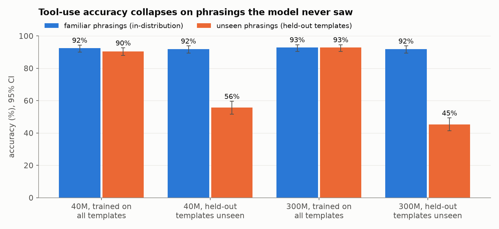
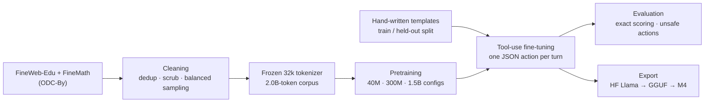
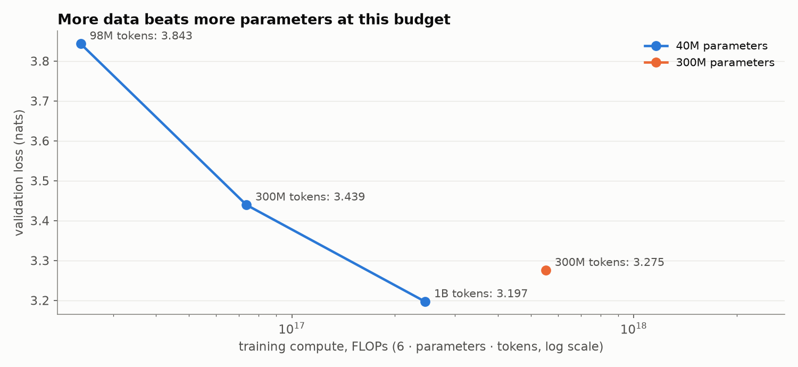
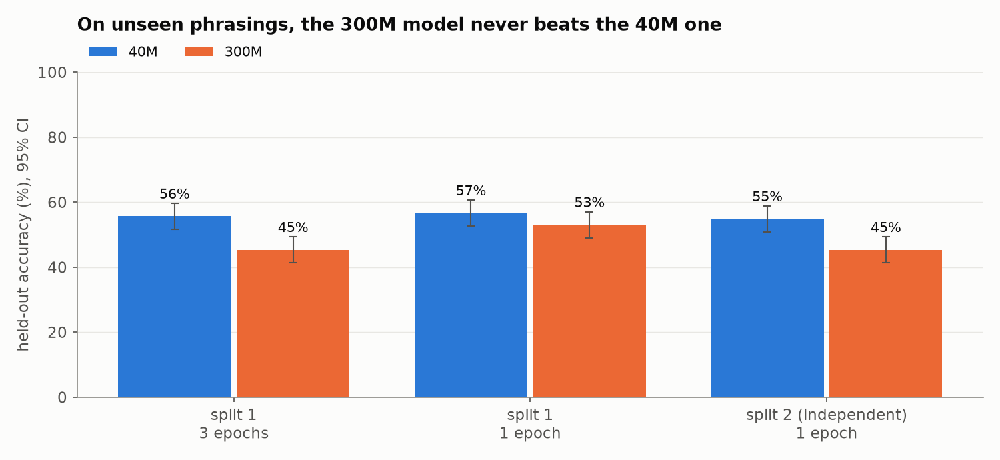

# Ivy-1.5B

### A small language model trained from scratch to control devices, and measured on what it has never seen.

> Ivy turns a request like *"move report.pdf to the archive on my laptop"* into exactly one action: a tool call on a specific
> device with exact arguments, a clarifying question, a refusal, or a plain answer. Every part of the model is built here, from
> the tokenizer to the GGUF file that runs on a laptop, on openly licensed data only.

**Status: the pipeline runs end to end at 40M and 300M parameters; the 1.5B run has not started, and no weights are released.**
The tokenizer is frozen, a 2.0B-token corpus is built, pretraining is tuned and resumable, tool-use fine-tuning and a fail-closed
evaluation work, and exported checkpoints match PyTorch in Hugging Face and llama.cpp. What the experiments have *not* shown is
that a bigger model is worth its cost at this budget: the [results](docs/07-results.md) say the bottleneck is data, and the
1.5B decision waits on a success criterion that is not yet set. Open decisions, next experiments and the release checklist are
in the [roadmap](docs/09-roadmap.md).

**88 tests, CPU only.** Exact commands for every reported number are in [`RUNBOOK.md`](RUNBOOK.md); the design record is in
[`docs/`](docs/README.md).

```console
$ PYTHONPATH=src .venv/bin/python -m pytest -q                                   # 88 tests, no GPU needed
$ PYTHONPATH=src .venv/bin/python -m ivy_model.train --config configs/ivy-300m.json --data … --compile --resume
$ PYTHONPATH=src .venv/bin/python -m ivy_model.sft_gen --n 20000 --split train --out data/sft/v1-train.jsonl
$ PYTHONPATH=src .venv/bin/python -m ivy_model.sft --config configs/ivy-40m.json --init … --epochs 1
$ PYTHONPATH=src .venv/bin/python evals/run_model.py --config … --ckpt … --scenarios evals/sft_heldout.jsonl --out out.jsonl
$ python3 evals/score.py --scenarios evals/sft_heldout.jsonl --outputs out.jsonl      # accuracy, Wilson CI, unsafe actions
$ PYTHONPATH=src .venv/bin/python -m ivy_model.export_hf --config … --ckpt … --out export/ivy-hf   # then GGUF
```

<picture>
  <source media="(prefers-color-scheme: dark)" srcset="docs/assets/seen-vs-unseen-dark.png">
  
</picture>

*The headline result: the same models that score ~92% on familiar phrasings drop to 45–56% on phrasings held out of training.*

## How it works



| Stage | What happens | Doc |
|---|---|---|
| Tokenizer | 32,768-token byte-level BPE, English, single digits, chat and tool special tokens; frozen | [02](docs/02-tokenizer.md) |
| Data | FineWeb-Edu + FineMath (85/15), exact dedup, secret scrubbing, balanced per-file sampling | [03](docs/03-data.md) |
| Pretraining | Llama-style decoder (RMSNorm, RoPE, SwiGLU, GQA, tied embeddings); deterministic, resumable | [01](docs/01-architecture.md), [04](docs/04-pretraining.md) |
| Fine-tuning | template-generated conversations; loss on the answer only; train/held-out template split | [05](docs/05-fine-tuning.md) |
| Evaluation | exact tool/device/argument scoring, unsafe actions counted, 2,285 scenarios across 5 sets | [06](docs/06-evaluation.md) |
| Export | Hugging Face Llama format with logit parity; GGUF via a one-line llama.cpp patch | [08](docs/08-export.md) |

Three model configurations: **40.9M**, **307.3M** and **1.46B** parameters, all with a 2,048-token context.

## Results so far

| Question | Finding |
|---|---|
| Best peak learning rate | 2.4e-3 at 40M, 1.2e-3 at 300M, both inside the tested range; seed noise ≈ 0.004 nats |
| More parameters or more data? | 40M on 1B tokens (loss 3.197) beats 300M on 300M tokens (3.275) at about half the compute |
| Does tool-use fine-tuning generalise? | **Not yet.** ~92% on familiar phrasings, **45–57% on held-out phrasings** |
| Does a bigger model generalise better? | **No evidence yet.** On unseen phrasings 300M never beats 40M; other metrics flip between template splits |
| How long to fine-tune? | 1 epoch beats 3 at 300M (53.0% vs 45.3% held-out, p < 0.0001); fine-tuning loss cannot show this |

<picture>
  <source media="(prefers-color-scheme: dark)" srcset="docs/assets/loss-vs-compute-dark.png">
  
</picture>

<picture>
  <source media="(prefers-color-scheme: dark)" srcset="docs/assets/split-sensitivity-dark.png">
  
</picture>

Tables, intervals, paired tests and caveats: [07 — Results](docs/07-results.md). The
[experiments notebook](kaggle/ivy_experiments.ipynb) reproduces every chart.

## Design decisions

Five choices that shaped the rest, with what each one cost.

### 1. From scratch, on openly licensed data only

Fine-tuning an existing open model would be faster and almost certainly score higher. But the goal includes a public release that
does not inherit an upstream model's licence, and proprietary models' terms typically forbid training competitors on their
outputs. So pretraining uses FineWeb-Edu and FineMath (ODC-By), tool-use data comes from hand-written templates, and an open
teacher model is allowed only if its licence explicitly permits training other models.

**What it costs.** Tokens. At ~1,570 tokens/s on the shared training GPU, a 1.46B model sees only 8–12B tokens in the 2–3 month
budget, 5–8 tokens per parameter. That single number is why model size is an open experimental question here rather than a given.

### 2. Measure the product task, and score it fail-closed

Validation loss is reported, but it does not tell you whether the model deletes the right file. The scorer compares the action,
and for tool calls the tool, the device and every argument, exactly. Anything that is not a JSON object is wrong. Acting when the
right answer was to ask, decline or reply is counted separately as an **unsafe action**, because for an assistant that executes
commands that is the error that matters.

**What it costs.** Harmless normalisation fails (`" Calendar"` with a leading space is wrong), and scores look lower than a
lenient scorer would make them. That is the intended direction of error.

### 3. Hold templates out, not just examples

The first fine-tuned 40M model scored 67% on the hand-designed v2 set, which looked like progress. The generator then got a
**template-held-out split**: every phrasing list and slot pool is divided by a stable hash, and a test set is built only from
phrasings and values the model never saw. The same recipe scores ~92% on familiar phrasings and ~56% on held-out ones. The gap,
not the headline, is the result, and it redirected the project from model size to data diversity.

**What it costs.** Templates and evals share one author, so even "held-out" is closer to training than real users will be. The
held-out score is closer to an upper bound than a lower bound.

### 4. One change per experiment, paired tests, and replication

Every comparison changes one setting, compares models on the same items with an exact McNemar test, and states its confidence
interval. A result that matters is rerun on an independent template split before it is believed.

**What it costs, and what it caught.** Time, and one retraction: on the first split a 300M model made significantly fewer unsafe
actions than a 40M one (p = 0.002). On an independent split the difference reversed. The claim was withdrawn, and no size claim
is now made from a single split.

### 5. Freeze the tokenizer early

Every checkpoint depends on the exact id mapping, so the tokenizer was frozen before pretraining and pinned by a hash test,
with seven reserved special tokens for future formats.

**What it costs.** It was frozen without code in its training text, so JSON tool calls take 15–20% more tokens than with code-aware
tokenizers. And stock llama.cpp did not recognise its pre-tokenizer; that one turned out to be a one-line converter patch, verified
on 2.47M tokens.

## What not to trust yet

- **Absolute tool-use scores.** One author wrote templates, evals and labels; there is no second annotator and no real-user data.
- **The 300M model as a size data point.** Its base saw ~1 token per parameter and is a weaker language model than the 40M base
  trained on 1B tokens. A 300M base on 1B tokens is training now.
- **Single-split comparisons**, including any in this repository's history. Results move more with the template split than with
  model size.
- **The scaling projection** in [`reports/scaling-fit-rough.json`](reports/scaling-fit-rough.json). It extrapolates far beyond
  two sizes and three token budgets; it is a scenario analysis.
- **On-device behaviour.** GGUF parity is verified on a Linux CPU build, not on the M4 or in quantised form.

## Quick start

Requirements: Linux, Python 3.12, an NVIDIA GPU with CUDA 13 for training. The tests run on CPU.

```bash
git clone https://github.com/Dhruv-Sharma29/Ivy-1.5B.git && cd Ivy-1.5B
python3.12 -m venv .venv
.venv/bin/pip install --extra-index-url https://download.pytorch.org/whl/cu130 -r requirements.lock.txt
PYTHONPATH=src .venv/bin/python -m pytest -q
```

From there, [`RUNBOOK.md`](RUNBOOK.md) walks through corpus building, pretraining, fine-tuning and evaluation step by step.

## Repository layout

```text
src/ivy_model/      model, training loop, data pipeline, chat format, SFT, export
configs/            model sizes (40M, 300M, 1.5B)
tokenizer/          the frozen tokenizer (ivy-bpe-32k) and the scripts that built it
evals/              eval sets, scorer, baselines, model runner
scripts/            the exact experiment scripts, common eval, Kaggle dataset/notebook builders
reports/            JSON results of the experiments
kaggle/             experiments notebook
export/llama_cpp/   llama.cpp converter patch and tokenization check
data-manifests/     data sources and licence-review status
docs/               design record (start at docs/README.md)
tests/              CPU test suite
```

Model weights, checkpoints and tokenized corpora are not stored in git.

## Docs

Start at [`docs/README.md`](docs/README.md) for the reading order. Highlights:

- [Charter](docs/00-charter.md): the problem, scope, non-goals and what "done" means
- [Evaluation](docs/06-evaluation.md): fail-closed scoring, unsafe actions, the held-out policy
- [Results](docs/07-results.md): every measurement, with intervals, paired tests and the retraction
- [Implementation notes](docs/10-implementation-notes.md): where the build proved the plan wrong
- [Roadmap](docs/09-roadmap.md): open decisions, next experiments, release checklist

## Data and licensing

Pretraining text comes from [FineWeb-Edu](https://huggingface.co/datasets/HuggingFaceFW/fineweb-edu) and
[FineMath](https://huggingface.co/datasets/HuggingFaceTB/finemath), both released under ODC-By (attribution required). Tool-use
training data is generated from hand-written templates (`src/ivy_model/sft_gen.py`); no teacher model or third-party model output
is used.

No licence has been chosen for this code or any future weights. Until a `LICENSE` file is added, all rights are reserved.

## Acknowledgements

Hugging Face for FineWeb-Edu and FineMath, and the llama.cpp project for the GGUF runtime.
